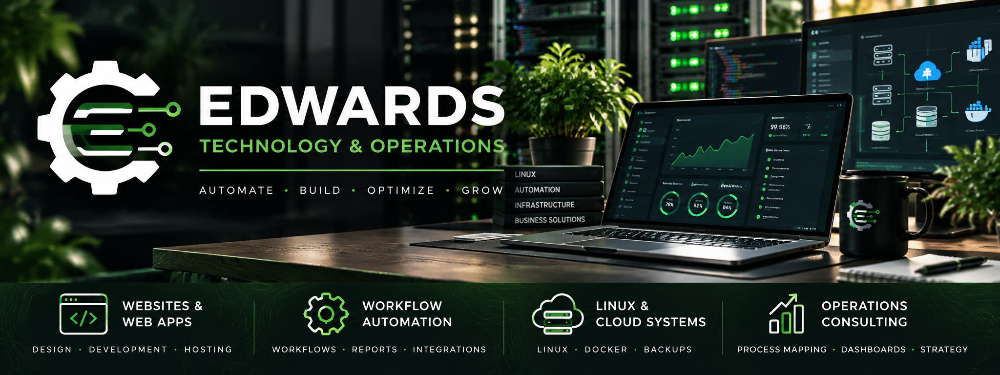

# Edwards Technology & Operations

A production-oriented **starter** for a small-business technology and operations agency, built with FastAPI, Jinja, SQLite, Docker, and a responsive public site. This is software infrastructure, **not** a registered legal entity or a finished operating business.

## Features

- Polished, responsive service website
- Inquiry form with validation and honeypot field
- Persistent SQLite inquiry records
- Read-only private `/admin` inquiries dashboard (HTTP Basic authentication)
- Docker deployment, health check, customizable brand/email
- No third-party tracking, no paid dependencies, no payment data collected

## Run locally with Docker

```bash
cp .env.example .env
# Edit .env: set your actual contact email and STRONG RANDOM ADMIN_PASSWORD.
docker compose up -d --build
curl http://127.0.0.1:8120/health
```

Visit http://localhost:8120/ (on the host machine). Admin: http://localhost:8120/admin

If running on `yeet` and connecting from your desktop, use an SSH tunnel:

```bash
ssh -L 8120:127.0.0.1:8120 yeet
```

Then open http://localhost:8120 on your desktop.

## Deployment notes

**Important:** Basic authentication sends credentials in an easily decodable form. Serve `/admin` **only over HTTPS** if exposing it to the internet, and preferably gate it behind a VPN or an identity-aware proxy. The Compose file binds to localhost by default. A publicly accessible reverse proxy should also add rate limiting, request-size limits, security headers, and anti-spam protections; the built-in honeypot is not sufficient for hostile internet traffic. Keep customer inquiry data private, back up the Docker volume, and define data retention/deletion procedures. Consider replacing Basic auth with modern authentication before expanding the admin panel. There is no public signup or payment capability in this starter.

To serve publicly, reverse proxy a dedicated business domain to `127.0.0.1:8120`. Do not accidentally overwrite existing Caddy routes on your server. Test TLS and privacy safeguards before collecting live inquiries.

## Push to GitHub

```bash
git init
git branch -M main
git add .
git commit -m "Launch technology and operations agency starter"
gh repo create edwards-technology-operations --public --source=. --remote=origin --push
```

Run these commands **inside this extracted folder**. `.env` and SQLite databases are excluded from Git. A public repository is useful as a portfolio; do not publish customer data or private client code.

## Business launch checklist

- [ ] Decide brand name and check domain/trademark conflicts
- [ ] Confirm legal registration, local licensing and tax requirements
- [ ] Obtain business insurance appropriate to the services you offer
- [ ] Get a dedicated business domain and email
- [ ] Establish client service agreement, scope of work, and privacy notice
- [ ] Set accurate service packages and proposal templates
- [ ] Test inquiry handling and set a routine for reviewing leads
- [ ] Obtain permission before displaying client logos/testimonials
- [ ] Find a first paying customer before expanding into a SaaS product

## Future improvements

Email notification with a real provider, user authentication, CRM statuses, proposal/invoice templates, client portal, payments, audit logs, backups and spam/rate limiting.

## License

Copyright (c) 2026. All rights reserved. See LICENSE.
